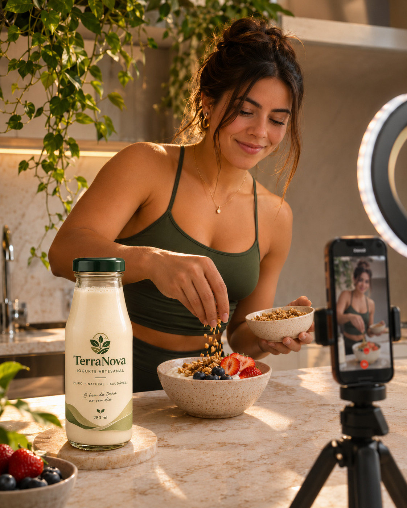

# Fotos do processo: prompts e onde buscar

As três fotos da seção "Do pasto à garrafa" entram em `assets/img/` com estes nomes:

| Arquivo | Etapa |
|---|---|
| `processo-1.jpg` | Leite do dia |
| `processo-2.jpg` | Fermentação lenta |
| `processo-3.jpg` | Envase em vidro |

**Formato:** horizontal 4:3. Gere em 2400×1800 (ou o maior que a ferramenta deixar) e exporte em **1600×1200, JPG qualidade 80** (cerca de 250 a 400 KB cada). Assim fica nítido sem pesar o site.

## Estilo que combina com o site

Luz quente de manhã, verde-floresta escuro e creme, toques de dourado, pouca saturação, fundo desfocado e granulação leve de filme. Nada de texto, logo ou rosto de pessoas: a garrafa 3D é a estrela, as fotos só dão contexto.

Cole este trecho no fim de cada prompt:

```
editorial food photography, cinematic warm early-morning light, deep forest green and warm cream color palette with subtle champagne-gold highlights, shallow depth of field, soft natural film grain, muted and elegant, premium magazine look, 4:3 aspect ratio, no text, no logos, no faces
```

Prompt negativo (se a ferramenta tiver):

```
text, letters, logo, watermark, plastic packaging, oversaturated colors, cartoon, illustration, 3d render, harsh flash, faces, cluttered background
```

## 1. Leite do dia (`processo-1.jpg`)

```
Early morning on a small family dairy farm in Minas Gerais, Brazil. Two vintage stainless steel milk cans and a clear glass pitcher of fresh milk resting on a weathered wooden bench, light mist over green pastures in the soft-focus background, golden sunrise backlight catching the rim of the cans, dew on the grass
```

## 2. Fermentação lenta (`processo-2.jpg`)

```
Small-batch artisanal yogurt fermenting in a clean rustic dairy kitchen. A row of wide glass jars filled with thick creamy white yogurt, covered with natural linen cloths, resting on an oak table, a simple dairy thermometer beside them, dark green tiled wall behind, soft warm light from a side window
```

## 3. Envase em vidro (`processo-3.jpg`)

```
Close-up of thick creamy white yogurt being poured into clear glass milk bottles on a wooden counter, a row of filled unlabeled glass bottles with dark green metal caps waiting beside them, a few drops on the glass, soft window light, calm and handcrafted atmosphere
```

## Se preferir banco de imagens gratuito

Unsplash e Pexels (licença livre, sem precisar dar crédito). Busque em inglês, que tem mais resultado:

- **Leite do dia:** `dairy farm sunrise`, `milk cans farm`, `fresh milk countryside`
- **Fermentação:** `homemade yogurt jars`, `fermentation kitchen`, `dairy kitchen rustic`
- **Envase:** `milk bottles glass`, `pouring milk bottle`, `dairy bottling`

Prefira fotos quentes, com fundo escuro ou verde. Se vier muito colorida, baixe um pouco a saturação e aqueça levemente no editor (Canva, Lightroom ou o próprio celular) para casar com o site.

---

# Campanha: fotos novas

## Influenciadores locais (`campanha-influenciadores.jpg`, retrato 4:5, mínimo 1200×1500)

Esta é a única peça da campanha que ainda está vazia no site. Aqui a pessoa pode aparecer, já que o tema é influenciador.

```
a young Brazilian fitness content creator in a bright home kitchen filming a breakfast recipe with a smartphone on a small tripod, a glass yogurt bottle with a dark green metal cap and cream label on the marble counter next to a bowl of granola and berries, ring light glow, candid moment, editorial food photography, cinematic warm early-morning light, deep forest green and warm cream color palette with subtle champagne-gold highlights, shallow depth of field, soft natural film grain, premium magazine look, 4:5 aspect ratio, no text, no logos
```

Depois de gerar, salve como `assets/img/campanha-influenciadores.jpg` e troque no `index.html` o bloco `photo-slot` dessa peça por:

```html
<figure class="camp__img"></figure>
```

## Fotos em resolução maior

As outras quatro fotos da campanha foram tiradas de dentro do PDF da apresentação, então estão pequenas (Instagram 337×421 e degustação 580×435 são as piores). Se vocês tiverem os arquivos originais, basta substituir mantendo o mesmo nome:

- `campanha-outdoor.jpg` (paisagem, ideal 2000×1125)
- `campanha-instagram.jpg` (retrato 4:5, ideal 1200×1500)
- `campanha-degustacao.jpg` (paisagem 4:3, ideal 1600×1200)
- `campanha-gondola.jpg` (paisagem, ideal 1600×900)
