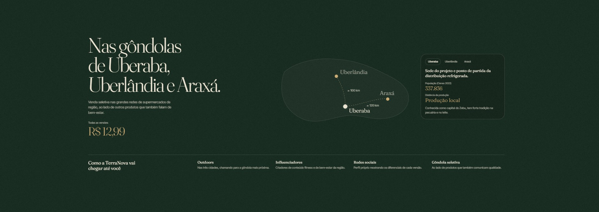
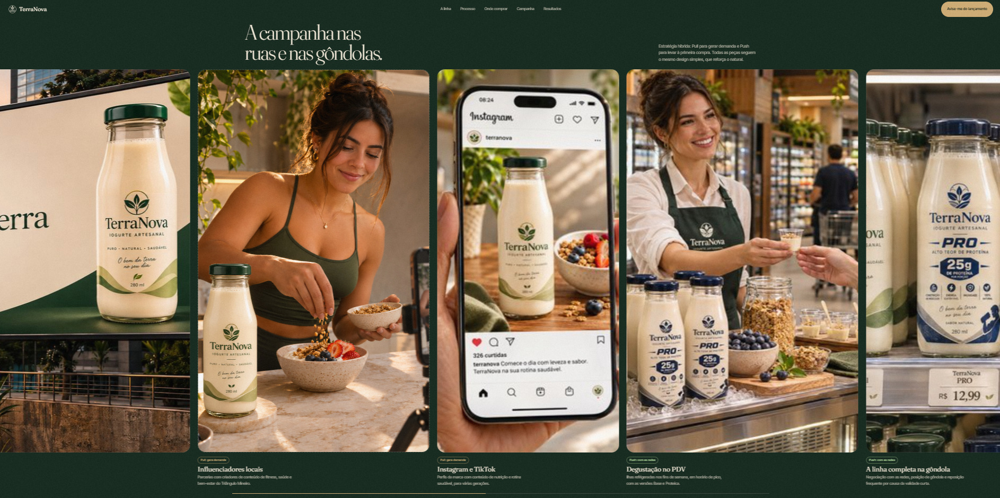
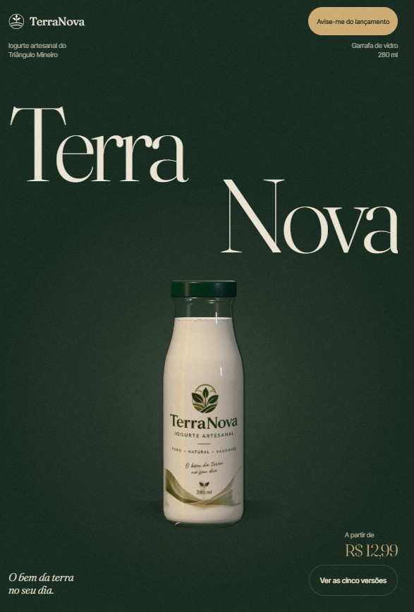

# 🥛 TerraNova: landing page 3D de um iogurte artesanal

Landing page de apresentação do **Iogurte TerraNova**, uma linha artesanal com cinco versões (Base, Proteica, Light, Kids e Senior). Uma **garrafa 3D fotorrealista, feita inteira em código**, acompanha a rolagem da página, troca de versão e mostra o rótulo e a tabela nutricional. Depois vêm a estratégia, a campanha e um painel de resultados, e o site termina com um cadastro de lançamento que envia e-mails de verdade.

Projeto acadêmico do **Planejamento de Marketing N2** da agência NewBrand, Universidade de Uberaba, 2026.


**🔗 [Ver o site publicado](https://kaike000708.github.io/TerraNova-3D-Landing-Page/)**


---

## Resumo

| | |
|---|---|
| **O que é** | Site de lançamento de um produto fictício, feito para apresentar em sala e compartilhar por link. |
| **Destaque** | Garrafa 3D sem arquivo de modelo: o formato foi medido nas fotos do produto e os rótulos reais foram "desenrolados" das fotos e aplicados no 3D. |
| **Dados do plano** | Matriz FOFA, 4 Ps, campanha Push e Pull e um painel planejado × realizado com o cenário simulado de 2027. |
| **Tecnologias** | HTML, CSS e JavaScript puros (módulos ES), Three.js, GSAP, Lenis e um shader WebGL. Sem framework e sem etapa de build. |
| **Funciona sem internet** | Bibliotecas e fontes estão dentro da pasta; só o envio do cadastro precisa de rede. |
| **Público do produto** | Classes B- e C+ do Triângulo Mineiro (Uberaba, Uberlândia e Araxá), R$ 12,99 por garrafa. |

---

## A página

São treze blocos em sequência, e a garrafa 3D muda de lugar, tamanho e giro em cada um:

1. **Carregamento:** a silhueta da garrafa enche de iogurte com o progresso real; a tampa fecha e o desenho vira a garrafa 3D no mesmo lugar.
2. **Abertura:** "Terra" e "Nova" em letras enormes, divididas pela garrafa no centro.
3. **Manifesto:** um parágrafo cujas palavras acendem conforme a rolagem.
4. **Ingredientes:** quatro anotações ligadas à garrafa por linhas finas.
5. **A linha:** a rolagem troca entre as cinco versões; a página muda de cor, a garrafa gira e troca o rótulo.
6. **Por que vidro:** motivos, números com fonte e como descartar.
7. **Do pasto à garrafa:** três etapas com fotos do processo.
8. **Onde comprar:** mapa do Triângulo Mineiro com cidades clicáveis, rotas animadas, os parceiros de lançamento (LS Guarato e Empório Bahamas) e o canal curto Fabricante → Varejista → Consumidor.
9. **Por que a TerraNova tem espaço:** matriz FOFA em que cada quadrante mostra como o plano responde, e o mix de marketing (4 Ps).
10. **A campanha:** outdoors, influenciadores, Instagram e TikTok, degustação e gôndola, em rolagem horizontal, cada peça marcada como Push ou Pull.
11. **Cinco versões, uma prateleira:** as cinco garrafas 3D numa gôndola, com as metas dos seis primeiros meses.
12. **Planejado × realizado:** painel do cenário simulado de 2027, com seis indicadores.
13. **Seja o primeiro a provar:** cadastro de lançamento com fundo animado em shader, e o rodapé.

| A linha | Rótulo e tabela nutricional |
|---|---|
|  |  |

| Onde comprar | Gôndola 3D |
|---|---|
|  |  |

| Estratégia (FOFA e 4 Ps) | Campanha |
|---|---|
|  |  |

| Planejado × realizado | Cadastro de lançamento |
|---|---|
|  |  |

---

## Como a garrafa 3D foi feita

- **Silhueta medida nas fotos.** O contorno da garrafa de vidro (280 ml) e da garrafinha PET da Kids (200 ml) foi medido pixel a pixel e guardado em [`js/perfil.js`](js/perfil.js) como pares `[raio, altura]`. Uma interpolação cúbica monótona gera a curva sem dobras, e a garrafa é "torneada" a partir dela (`LatheGeometry`).
- **Rótulos tirados das fotos.** Um script em Python "desenrolou" cada rótulo do cilindro (projeção cilíndrica, 140° da volta), separou só a tinta com transparência e corrigiu sombra e balanço de branco. O resultado está em [`assets/labels/`](assets/labels/).
- **Verso do rótulo gerado em tempo real** num canvas: ingredientes, alérgicos, conservação, validade, código de barras e a tabela nutricional no modelo da Anvisa (RDC 429/2020 e IN 75/2020).
- **Vidro sem transmissão.** Em vez de transmissão (que escurecia com fundo transparente), o vidro soma só os reflexos de um estúdio com softboxes, uma borda de Fresnel e um fundo de vidro translúcido.
- **Troca de versão:** a garrafa gira até o verso, troca a arte escondida e termina sempre de frente.
- **Gôndola presa à página:** as cinco garrafas entram e saem junto com a prateleira, no mesmo ritmo da rolagem.

### Desempenho

- Só redesenha quando algo muda (rolagem, troca de versão, mouse) e não desenha fora da tela.
- Limita a resolução a 1,75× e baixa para 1× sozinha se a máquina ficar lenta.
- Rótulos enviados à GPU e shaders compilados durante o carregamento, para não travar depois.
- O fundo em shader do cadastro roda em meia resolução e só quando está na tela.
- Se o navegador não tiver WebGL, a página mostra a foto do produto no lugar.

---

## Funcionalidades

| Funcionalidade | Como funciona |
|---|---|
| Modo apresentação | Setas ← → (ou Page Up/Down, como num passador de slides) pulam de seção; na linha, de versão em versão |
| Troca de versão pela rolagem | Seção fixa com abas, barra de progresso e a cor da página por versão |
| Mapa interativo | Cidades clicáveis, rotas animadas em SVG, cartão com população (IBGE, Censo 2022), distância e parceiro |
| Matriz FOFA | Uma luz segue o cursor e revela como o plano responde a cada ponto; no celular a resposta fica sempre visível |
| Campanha horizontal | A rolagem vertical anda as peças para o lado; no celular vira lista |
| Gôndola 3D | Cinco garrafas que "respiram"; a do mouse vem para a frente; clique leva à versão |
| Metas do plano | 10 pontos de venda, 120.000 unidades e 30% de reconhecimento, com contagem animada |
| Painel planejado × realizado | Seis abas (vendas, pontos de venda, redes sociais, avaliações, reconhecimento e plano de ação), meta em dourado, Stand by tracejado, ação corretiva de cada mês e visão em tabela |
| Fundo em shader | "Creme escorrendo" em WebGL nas cores da marca, que reage ao mouse |
| Cadastro de lançamento | E-mail e cidade, campo anti-robô, envio pelo [FormSubmit](https://formsubmit.co) sem servidor próprio, com limite de 20 s e mensagem de erro clara |

**Acessibilidade:** link para pular ao conteúdo, foco visível, navegação pelo teclado no seletor, no mapa, na matriz e no painel, textos alternativos, tabela com os dados dos gráficos e `prefers-reduced-motion` (sem animações para quem pede).

**Telas testadas:** 1920×1080, 1440×900, 1366×768 e celulares de 390 e 360 px.

<p align="center">
  
</p>

---

## Como rodar

O site usa módulos JavaScript, então **não abre com duplo clique** no `index.html`. Precisa de um servidor local:

- **VSCode:** extensão **Live Server** → botão direito no `index.html` → *Open with Live Server*.
- **Terminal:** `npx serve .` ou `python -m http.server`.

Para publicar, qualquer hospedagem estática serve (GitHub Pages, Netlify, Vercel), sem build.

Para mudar textos, cores, rótulos, a posição da garrafa em cada seção, os números do painel ou o e-mail do cadastro, veja o [**guia de edição**](docs/EDITAR.md).

---

## Estrutura

```
├── index.html              # seções da página e importmap
├── css/style.css           # cores e fontes em :root, layout e responsivo
├── js/
│   ├── main.js             # rolagem, quadros-chave da garrafa, mapa, campanha, formulário, rodapé
│   ├── bottle3d.js         # cena Three.js: garrafa, rótulos, luz, gôndola
│   ├── perfil.js           # silhueta das garrafas medida nas fotos
│   ├── variants.js         # as 5 versões, rótulo e cálculo da tabela nutricional
│   ├── painel.js           # painel planejado × realizado (gráficos em SVG)
│   ├── dados2027.js        # números simulados de 2027
│   ├── creme.js            # fundo em shader WebGL do cadastro
│   ├── config.js           # e-mail do cadastro e dados do desenvolvedor
│   └── vendor/             # Three.js, GSAP, Lenis
├── assets/
│   ├── img/                # fotos das versões, do processo e da campanha
│   ├── labels/             # rótulos extraídos das fotos (WebP com transparência)
│   └── fonts/              # Fraunces e Inter Tight (woff2)
├── screenshots/            # capturas usadas neste README
├── docs/
│   └── EDITAR.md           # guia de edição do site
├── PROMPTS-IMAGENS.md      # prompts usados para gerar as fotos
├── LICENSE
└── THIRD_PARTY_NOTICES.md
```

---

## Decisões de design

- **Paleta:** verde-floresta `#16291e`, creme do iogurte `#efe7d6` e dourado champanhe `#cfae74`, mais uma cor de fundo por versão.
- **Tipografia:** Fraunces fina em escala de cartaz para títulos e Inter Tight para o texto.
- **Um momento de destaque por seção:** as animações respondem à rolagem ou ao mouse, sem animação em tudo.
- **Gráficos:** uma cor só para o realizado, a meta como traço dourado e o Stand by tracejado, sem eixo duplo.
- **Referência visual:** a ideia de tipografia em escala de cartaz veio do site da Hungry Tiger (eathungrytiger.com), traduzida para a paleta e a identidade da TerraNova.

## Observações

- **Valores nutricionais estimados** para o projeto acadêmico (e marcados assim no site). Antes de qualquer uso em embalagem real, precisam ser validados por um nutricionista.
- **Números do painel de 2027 simulados** para a apresentação, a partir das metas e da regra do Stand by do plano.
- As **fotos do processo** e a dos **influenciadores** foram geradas por IA a partir dos prompts em [`PROMPTS-IMAGENS.md`](PROMPTS-IMAGENS.md). As demais fotos da campanha vêm da apresentação do grupo.
- As distâncias de ≈ 100 km até Uberlândia e ≈ 120 km até Araxá são estimativas.

---

## Equipe

Agência **NewBrand**, Universidade de Uberaba:

- Daniel Tiburcio de Oliveira
- Kaike Garcia Oliveira (desenvolvimento do site)
- Rayson Aparecido Mariano Nunes
- Vítor Almeida Prado
- Wesley Jacomine de Oliveira Bispo

## Licença

O **código** (HTML, CSS e JavaScript em `js/`, fora de `js/vendor/`) está sob a licença **MIT** ([`LICENSE`](LICENSE)).

A **marca TerraNova**, as **fotos**, os **rótulos** e o logo da NewBrand pertencem ao projeto acadêmico e **não** estão cobertos pela licença MIT. As bibliotecas e fontes incluídas seguem as próprias licenças, listadas em [`THIRD_PARTY_NOTICES.md`](THIRD_PARTY_NOTICES.md).

## Fontes

- [IBGE Cidades](https://cidades.ibge.gov.br/): população do Censo 2022
- [Portal da Indústria](https://www.portaldaindustria.com.br/): índice de reciclagem de vidro de 30% em 2023 (Abividro)
- Resolução CONAMA nº 275/2001: verde para vidro
- Portaria SDA/MAPA nº 1.174/2024: conservação até 10 °C
- IN 75/2020 e RDC 429/2020 da Anvisa: modelo da tabela nutricional
- Planejamento de Marketing N2 (NewBrand): FOFA, 4 Ps, campanha, metas e plano de ação
