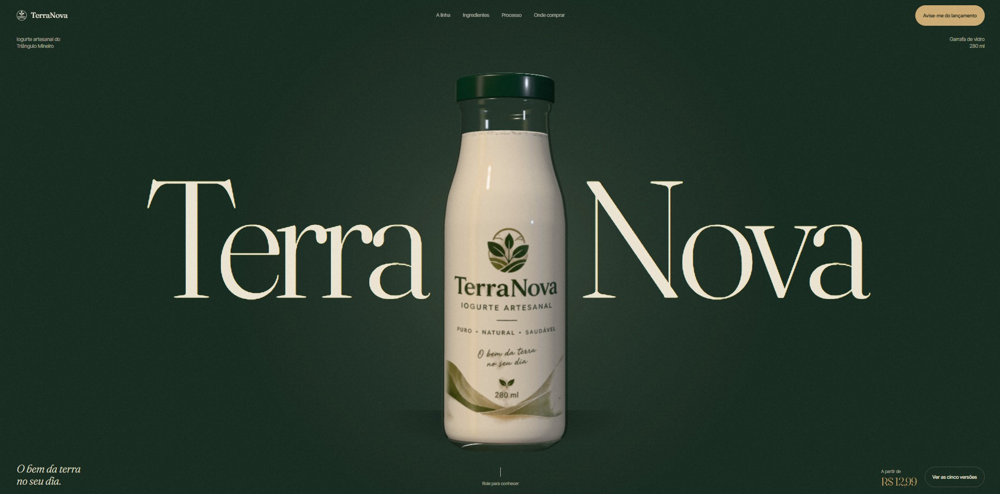
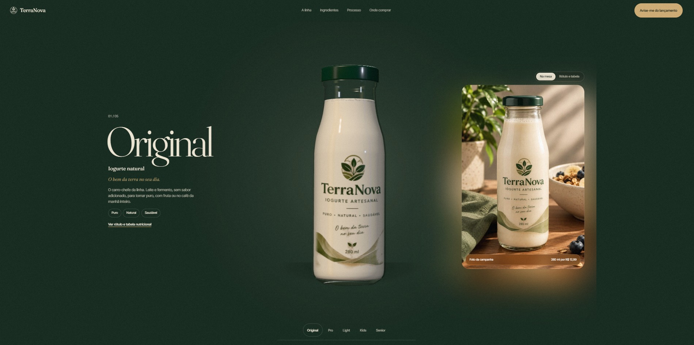
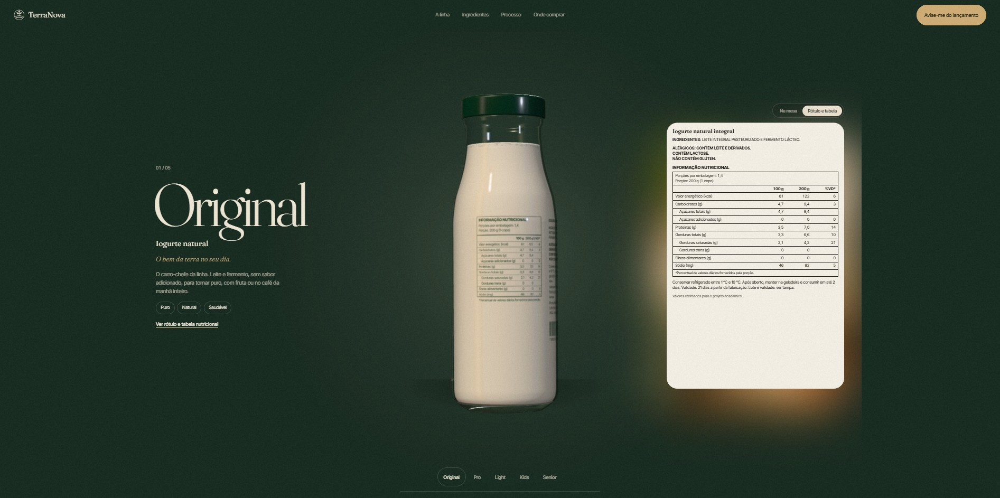
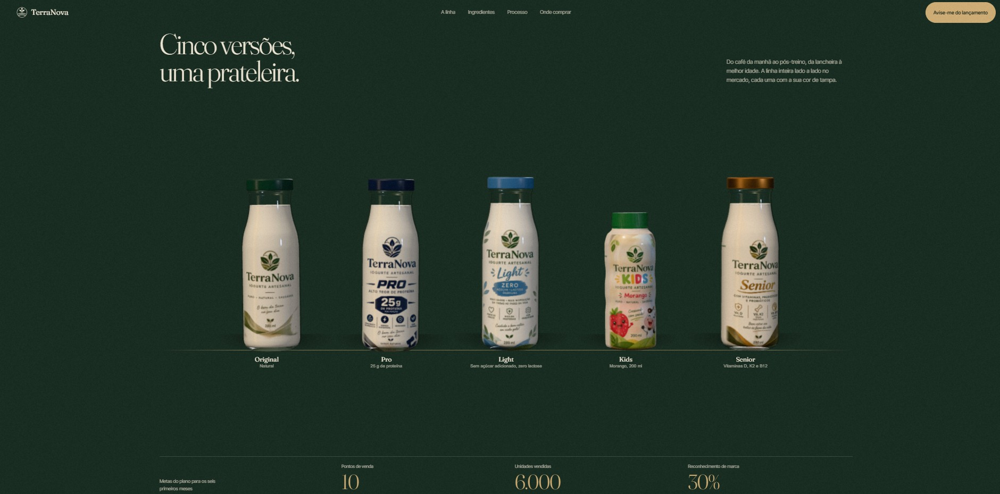
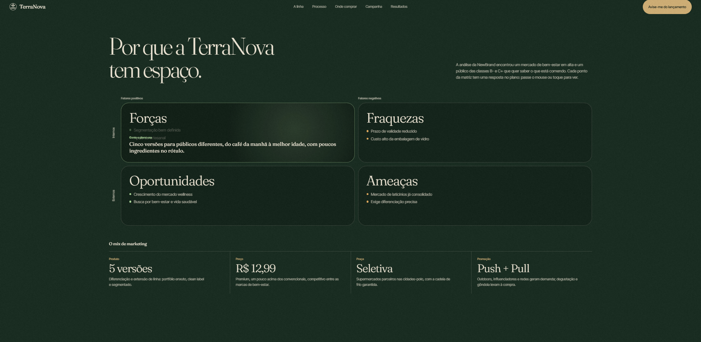
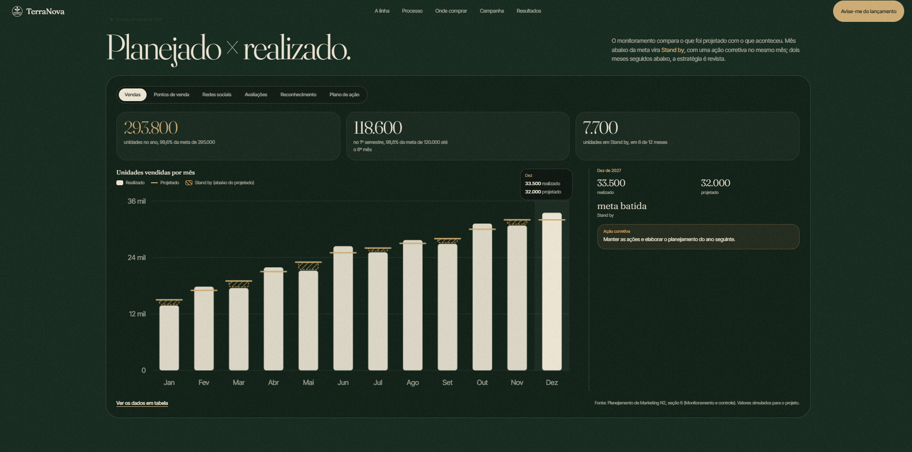
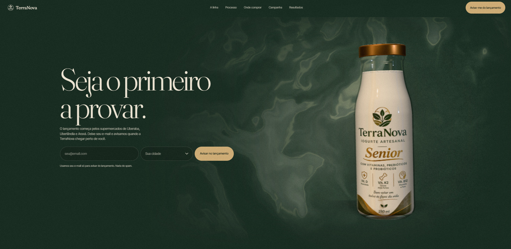

# TerraNova: landing page

Landing page de apresentação do Iogurte TerraNova (Planejamento de Marketing N2, agência NewBrand, Universidade de Uberaba, 2026).

**[Ver o site no ar](https://kaike000708.github.io/TerraNova-3D-Landing-Page/)**



## Prints

| | |
|---|---|
|  |  |
| **A linha:** cada versão troca a cor da página e a garrafa 3D | **Rótulo:** a garrafa gira até o verso e mostra a tabela nutricional |
|  |  |
| **Onde comprar:** mapa com as cidades-polo e os parceiros | **Gôndola:** as cinco garrafas na prateleira, com hover |
|  |  |
| **Estratégia:** matriz FOFA e mix de marketing (4 Ps) | **Campanha:** peças Push e Pull em rolagem horizontal |
|  |  |
| **Resultados:** painel planejado × realizado de 2027 | **Cadastro:** formulário com fundo animado em shader |

<p align="center"></p>

## O que tem no site

A página conta a história do produto na ordem do planejamento de marketing:

1. **Abertura:** a garrafa 3D da versão Base, o nome da marca e o preço (R$ 12,99).
2. **Manifesto:** as palavras acendem conforme a rolagem.
3. **Ingredientes:** o que entra (e o que não entra) no iogurte.
4. **A linha:** as cinco versões (Base, Proteica, Light, Kids e Senior). Cada uma troca a cor da página, a tampa e o rótulo da garrafa 3D, com foto, benefícios e o botão "Ver rótulo e tabela nutricional".
5. **Por que vidro:** vantagens da embalagem, números de reciclagem e como descartar.
6. **Do pasto à garrafa:** o processo em três etapas, com fotos.
7. **Onde comprar:** mapa interativo de Uberaba, Uberlândia e Araxá (população, distância, parceiros LS Guarato e Empório Bahamas) e o canal curto Fabricante → Varejista → Consumidor.
8. **Por que a TerraNova tem espaço:** matriz FOFA interativa e o mix de marketing (4 Ps).
9. **A campanha:** outdoors, influenciadores, Instagram/TikTok, degustação e gôndola, cada peça marcada como Push ou Pull.
10. **Cinco versões, uma prateleira:** as cinco garrafas 3D lado a lado e as metas dos seis primeiros meses (10 pontos de venda, 120.000 unidades, 30% de reconhecimento).
11. **Planejado × realizado:** painel do cenário simulado de 2027.
12. **Seja o primeiro a provar:** cadastro de e-mail e cidade, com fundo animado.
13. **Rodapé:** navegação, cidades, equipe e crédito de desenvolvimento.

## Funcionalidades

- **Garrafa 3D realista** que gira e muda de lugar conforme a rolagem, com a tampa, o rótulo e o verso de cada versão.
- **Tela de carregamento** em que a silhueta da garrafa enche de iogurte com o progresso real.
- **Rótulo no padrão brasileiro:** ingredientes, alérgicos e tabela nutricional no modelo da Anvisa, com porção de 200 g e %VD.
- **Gôndola com movimento:** as garrafas "respiram", a do mouse vem para a frente, e a prateleira entra e sai presa à rolagem.
- **Matriz FOFA com hover:** uma luz segue o cursor e revela como o plano responde a cada ponto.
- **Campanha em rolagem horizontal** no computador e em lista no celular.
- **Painel de dados** com seis abas, tooltips, ação corretiva de cada mês e visualização em tabela.
- **Fundo em shader (WebGL)** na chamada final, que reage ao mouse e só roda quando está na tela.
- **Cadastro real por e-mail** (FormSubmit), com proteção contra robôs, limite de 20 s e mensagens de erro claras.
- **Modo apresentação:** setas do teclado ou passador de slides pulam de seção em seção.
- **Responsivo:** testado em 1920, 1440, 1366, 390 e 360 px de largura, sem nada passando da tela e com área de toque confortável no celular.
- **Acessibilidade:** navegação por teclado, foco visível, textos alternativos, tabela para quem não enxerga os gráficos e respeito à opção de reduzir movimento do sistema.
- **Desempenho:** 3D redesenhado só quando algo muda, resolução que se ajusta à máquina e tudo funcionando sem internet (exceto o formulário).

## Tecnologias

HTML, CSS e JavaScript puros (sem build), [Three.js](https://threejs.org) para o 3D, [GSAP](https://gsap.com) para as animações, [Lenis](https://lenis.darkroom.engineering) para a rolagem suave, WebGL para o fundo em shader, gráficos em SVG feitos à mão e [FormSubmit](https://formsubmit.co) para o formulário.

## Equipe

Projeto do grupo para a disciplina de Marketing (agência NewBrand, Universidade de Uberaba). Desenvolvimento do site: Kaike Garcia Oliveira.

## Como foi feito

A garrafa 3D é feita em código com Three.js. O formato foi medido nas fotos dos produtos, e os rótulos são as próprias artes das fotos, "desenroladas" do cilindro e salvas em `assets/labels/` (só a tinta, com transparência). Por cima entram o vidro com reflexos de estúdio, o iogurte por dentro, a espuma no gargalo e a tampa de cada versão. As bibliotecas e as fontes estão dentro da pasta, então o site funciona **sem internet** (bom para apresentar na sala).

## Como abrir no VSCode

O site usa módulos JavaScript, então **não abre com duplo clique** no `index.html`. É preciso um servidor local:

1. Abra a pasta `terranova-site` no VSCode (Arquivo → Abrir pasta).
2. Instale a extensão **Live Server** (Ritwick Dey).
3. Clique com o botão direito no `index.html` → **Open with Live Server**.

Alternativa pelo terminal (com Node instalado): `npx serve .` e abra o endereço que aparecer.

## Tela de carregamento

Enquanto o 3D prepara, a silhueta da garrafa enche de iogurte com o progresso real (rótulos enviados à GPU um por um e sombreadores compilados antes de aparecer). No fim, a tampa fecha e o desenho vira a garrafa 3D no mesmo lugar. A silhueta vem de `js/perfil.js`, a mesma usada pelo 3D.

## Desempenho

A garrafa só é redesenhada quando algo muda (rolagem, troca de versão, mouse) e não é desenhada quando está fora da tela. Se a máquina estiver lenta, a resolução do 3D baixa sozinha.

## Receber os e-mails do cadastro

O formulário "Seja o primeiro a provar" envia e-mail e cidade pelo FormSubmit (gratuito, sem servidor). Os cadastros vão para o e-mail definido em `js/config.js` (hoje: kaike.garcia10@gmail.com). Faça um cadastro de teste: na primeira vez o FormSubmit pode pedir para confirmar o endereço por e-mail.

O envio precisa de internet e funciona melhor com o site publicado (GitHub Pages). Bloqueadores de anúncio podem barrar o envio. Se o FormSubmit não responder em 20 segundos, o site avisa em vez de ficar carregando.

## Rótulo e tabela nutricional

Na seção "A linha", o botão "Ver rótulo e tabela nutricional" gira a garrafa 3D até o verso e mostra ingredientes, alérgicos e a tabela no modelo da Anvisa (RDC 429/2020 e IN 75/2020). Os valores ficam em `js/variants.js` (campo `nutri`, por 100 g) e são **estimados para o projeto**: confiram com um nutricionista se forem usar em embalagem real.

## Crédito de desenvolvimento

No rodapé, o nome do Kaike abre um cartão com o papel dele no projeto. Para mostrar LinkedIn, GitHub ou Instagram no cartão, preencha os links em `DESENVOLVEDOR`, dentro de `js/config.js`.

## Modo apresentação

Use **←** e **→** (ou Page Up / Page Down, como num passador de slides) para pular de seção em seção. Na seção "Linha", cada toque troca para a próxima versão do iogurte. O site foi testado em 1920×1080, 1440×900, 1366×768 (notebook/projetor) e no celular.

## Estrutura

```
terranova-site/
├── index.html          ← textos e seções da página
├── screenshots/        ← prints usados neste README
├── css/style.css       ← cores, fontes, layout (variáveis no topo, em :root)
├── js/
│   ├── variants.js     ← as 5 versões: nome, textos, cores, foto, tipo de garrafa
│   ├── perfil.js       ← silhueta das garrafas (medida nas fotos)
│   ├── bottle3d.js     ← a garrafa 3D (materiais, luz de estúdio, rótulos)
│   ├── main.js         ← rolagem, troca de versão, campanha horizontal, formulário, modo apresentação
│   ├── painel.js       ← painel "Planejado × realizado" (gráficos em SVG, abas, tabela)
│   ├── creme.js        ← fundo em shader da chamada final (creme escorrendo, segue o mouse)
│   ├── dados2027.js    ← números do cenário simulado de 2027 (mude aqui e o painel se atualiza)
│   └── vendor/         ← three.js, gsap, lenis (não precisa mexer)
└── assets/
    ├── img/            ← fotos das versões, processo, campanha e newbrand
    ├── labels/         ← artes dos rótulos aplicadas na garrafa 3D
    └── fonts/          ← Fraunces e Inter Tight
```

## Estratégia, campanha e painel de resultados

- **Por que a TerraNova tem espaço**: matriz FOFA (forças, fraquezas, oportunidades, ameaças) em que cada quadrante mostra, ao passar o mouse ou tocar, como o plano responde; abaixo, o mix de marketing (4 Ps). No celular as respostas ficam sempre visíveis.

- **Campanha**: seção com rolagem horizontal (a rolagem vertical anda as peças para o lado). No celular vira uma lista vertical. As fotos ficam em `assets/img/campanha-*.jpg`; incluindo a de influenciadores (`campanha-influenciadores.jpg`, gerada com o prompt em `PROMPTS-IMAGENS.md`).
- **Planejado × realizado**: painel com seis abas (Vendas, Pontos de venda, Redes sociais, Avaliações, Reconhecimento, Plano de ação), números-resumo calculados dos dados, meta marcada em dourado, Stand by em tracejado, ação corretiva de cada mês ao passar o mouse e opção de ver tudo em tabela. Os valores são simulados e ficam em `js/dados2027.js`.

## O que dá para mudar facilmente

**Textos e cores de cada versão:** `js/variants.js`. `fundo` é a cor que a página assume quando aquela versão aparece, `liquido` é a cor do iogurte, `tampa` e `tampaMetal` definem a tampa, e `rotulo` aponta para a arte em `assets/labels/`.

**Trocar a arte de um rótulo:** substitua o arquivo em `assets/labels/` por outro com o mesmo nome. A imagem cobre a frente da garrafa (140° da volta); o topo da imagem fica no ombro da garrafa e a base perto do fundo. Use PNG ou WebP com fundo transparente.

**Fotos:** coloque os arquivos em `assets/img/` com o mesmo nome. Os prompts para gerar as fotos do processo estão em `PROMPTS-IMAGENS.md`. Os espaços pontilhados da seção "Do pasto à garrafa" procuram `processo-1.jpg`, `processo-2.jpg` e `processo-3.jpg`. Enquanto o arquivo não existir, aparece o espaço vazio com a legenda.

**Posição da garrafa em cada seção:** cada `<section>` no `index.html` tem `data-bottle="x, y, escala, voltas, sombra, gôndola"`.
- `x` e `y` vão de -1 a 1 (−1 = esquerda/baixo, 1 = direita/cima; valores maiores que 1 tiram a garrafa da tela).
- `escala` 1 ≈ 74% da altura da tela.
- `voltas` é quantas voltas a garrafa já deu ao chegar ali (a rolagem gira a garrafa entre uma seção e outra).
- `sombra` 1 mostra a sombra embaixo da garrafa, 0 esconde.
- `gôndola` 1 mostra as cinco garrafas lado a lado na prateleira (seção "Cinco versões, uma prateleira"), 0 esconde.
- `data-bottle-m` é a mesma coisa para celular.

**Formato da garrafa:** `PERFIL` em `js/perfil.js`. Cada par é `[raio, altura]` em pixels da foto, de baixo para cima; a garrafa é "torneada" a partir dele. Há um perfil `vidro` (280 ml) e um `pet` (Kids, 200 ml).

**Cores gerais:** variáveis no topo de `css/style.css` (`--campo`, `--soro`, `--ouro`...).

## Inspiração

Estrutura inspirada em eathungrytiger.com: tipografia em escala de cartaz, um canvas de cor única com um acento só, botões em pílula, divisores pontilhados e marca d'água botânica. A paleta trocou o ferrugem/dourado da Hungry Tiger pelo verde de pasto e o creme do iogurte, com a cor de cada versão da linha tomando a página quando ela aparece.

## Fontes dos dados

Textos, metas, matriz FOFA, 4 Ps, campanha e plano de ação vêm do Planejamento de Marketing N2 da NewBrand. Os números do painel de 2027 são **simulados** para a apresentação. A população das cidades é do Censo 2022 (IBGE).

## Observação

Os textos sobre ingredientes, processo e benefícios foram escritos a partir do planejamento e dos rótulos. Confiram com o grupo antes de apresentar (por exemplo: lista exata de ingredientes, de onde vem o leite, se a garrafa é retornável).
